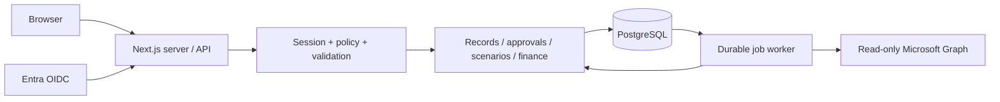

# Architecture and security

The application is a modular monolith. Server handlers authenticate a DB-backed opaque session, validate inputs, and call an explicit domain service. Data classes and operation grants are checked independently of role labels. DB runtime credentials are separate from migration ownership. Tenant RLS is defense in depth; server policy handles org/reporting scopes.

Workers, directory accounts, protected identity, positions, assignments, demand and compensation are separate tables. Each entity stores a typed registry-governed JSON payload within a common versioned envelope. Historical snapshots are restricted server data; audit metadata contains operation/field identifiers rather than full values. UUID links must remain in the same tenant. Calendar date intervals are [from,to).

Threat boundaries: all URLs are public; client hiding is not authorization. Import/job actors are checked again at commit. Entra tokens and Graph secrets remain server-side. The Graph adapter accepts only HTTPS graph.microsoft.com/v1.0 continuations for the expected resource, and refuses redirect-following. No matching on names/email is permitted.

Read salary and read identity are different permissions. Security administration does not implicitly grant either. Sensitive grant/mapping approval requires another authorized person. Group refresh replaces entitlements and invalidates affected sessions; stale snapshots deny group grants. App-role claim freshness has a different limit; see ENTRA.md.

Current assurance limitations: release security acceptance is incomplete. Historical hierarchy scope, complete report filtering, scenario financial isolation, inference protection across reports, privacy retention/deletion, runtime CSP nonce coverage, and authenticated E2E still require validation or implementation. The hash-chain audit needs external anchoring/restore verification before it can substantiate stronger tamper-evidence claims.

Sources consulted: [Next.js authentication](https://nextjs.org/docs/app/guides/authentication), [Graph user delta](https://learn.microsoft.com/en-us/graph/delta-query-users), [PostgreSQL range constraints](https://www.postgresql.org/docs/current/rangetypes.html), [PostgreSQL btree_gist](https://www.postgresql.org/docs/current/btree-gist.html).
